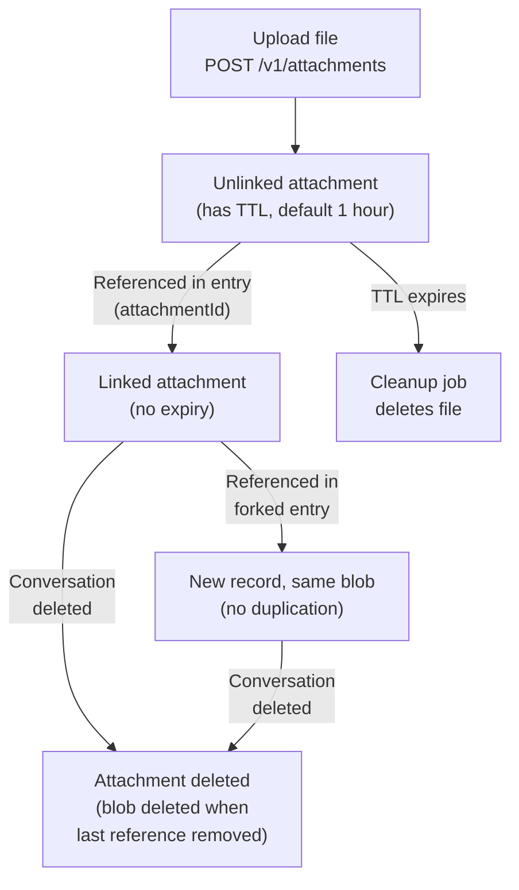

Attachments let you include binary files — images, audio, video, documents — in conversation entries, with server-managed storage, access control, signed download URLs, and automatic lifecycle management.
For production deployments, review the [attachment hardening recommendations](/docs/deployment/security/#attachments) before exposing downloads to browsers.

## Overview

There are two ways to attach files to conversation entries:

1. **External URL references** — Provide an `href` and `contentType` to point at an externally-hosted resource. The Memory Service stores the reference but does not manage the file.
2. **Server-stored attachments** — Upload the file to the Memory Service, receive an `attachmentId`, and include it when appending an entry. The server stores the file, manages access control, and handles cleanup.

## External URL References

The simplest way to attach files is to reference an externally-hosted resource directly. Provide an `href` and `contentType` in the content block's `attachments` array when appending an entry:

```bash
curl -X POST "http://localhost:8080/v1/conversations/{conversationId}/entries" \
  -H "Content-Type: application/json" \
  -H "Authorization: Bearer <token>" \
  -d '{
    "channel": "history",
    "contentType": "history",
    "content": [
      {
        "role": "USER",
        "text": "Analyze this diagram",
        "attachments": [
          {
            "href": "https://example.com/diagram.png",
            "contentType": "image/png",
            "name": "architecture-diagram.png"
          }
        ]
      }
    ]
  }'
```

The Memory Service stores the reference as-is — it does not download or manage the external file. This works well when your files are already hosted elsewhere and you just need to record them alongside the conversation.

The rest of this page covers **server-stored attachments**, where the Memory Service manages the file for you.

## Server-Stored Attachment Lifecycle



An attachment moves through three lifecycle stages:

- **Uploading** — File is being transferred to the server (or, for a URL, downloaded). A short-lived expiration is set to handle abandoned uploads. Its `status` is `uploading` or `downloading`, or `failed` if the transfer did not complete.
- **Unlinked** — Upload complete (`status` is `ready`) but not yet referenced by any entry. Has a finite TTL (default 1 hour). The uploader can delete it manually or let it expire.
- **Linked** — Referenced by an entry. Expiration is cleared. The attachment persists as long as the conversation exists.

Only a `ready` attachment can be linked. See [Checking Attachment Status](#checking-attachment-status).

## Uploading Files

Upload a file with a multipart form POST:

```bash
curl -X POST "http://localhost:8080/v1/attachments?expiresIn=PT1H" \
  -H "Authorization: Bearer <token>" \
  -F "file=@photo.jpg"
```

Response:

```json
{
  "id": "7c9e6679-7425-40de-944b-e07fc1f90ae7",
  "href": "/v1/attachments/7c9e6679-7425-40de-944b-e07fc1f90ae7",
  "contentType": "image/jpeg",
  "filename": "photo.jpg",
  "size": 204800,
  "sha256": "e3b0c44298fc1c149afbf4c8996fb924...",
  "expiresAt": "2025-01-28T11:30:00Z",
  "status": "ready"
}
```

| Field         | Description                                                                 |
| ------------- | --------------------------------------------------------------------------- |
| `id`          | Unique attachment identifier (use as `attachmentId` when appending entries) |
| `href`        | Server path to download the attachment                                      |
| `contentType` | Detected MIME type                                                          |
| `filename`    | Original filename                                                           |
| `size`        | File size in bytes                                                          |
| `sha256`      | SHA-256 hash of the file contents                                           |
| `expiresAt`   | When the unlinked attachment will be cleaned up                             |
| `status`      | Processing status (`ready` when upload is complete)                         |

**Notes:**

- `expiresIn` is an ISO 8601 duration (default `PT1H`, max `PT24H`)
- Maximum file size is [10 MB by default (configurable)](/docs/configuration/#attachment-storage)
- The uploaded attachment is unlinked until referenced in an entry
- Without an `id` field, every request creates a new attachment. To make an upload safe to retry, send your own `id`. See [Retrying Uploads and URL Creation](#retrying-uploads-and-url-creation).

### Creating an Attachment from a URL

Send a JSON body with a `sourceUrl` instead of a file, and the Memory Service downloads the content for you:

```bash
curl -X POST "http://localhost:8080/v1/attachments" \
  -H "Content-Type: application/json" \
  -H "Authorization: Bearer <token>" \
  -d '{
    "sourceUrl": "https://example.com/generated-image.png",
    "contentType": "image/png",
    "name": "generated-image.png"
  }'
```

The response is `201` and returns immediately with `"status": "downloading"`. The download has not finished at that point. Look the attachment up until its status is `ready` (see [Checking Attachment Status](#checking-attachment-status)) before linking it to an entry.

URL creation is not a durable background task. If the Memory Service stops while a download is running, the attachment can stay `downloading` until the cleanup job removes it after `expiresAt`. Delete it, or let it expire, and create it again.

## Checking Attachment Status

Every attachment has a `status`:

| Status        | Meaning                                                                                     |
| ------------- | ------------------------------------------------------------------------------------------- |
| `ready`       | The content is stored. This is success.                                                     |
| `uploading`   | A multipart upload with a caller-supplied `id` is storing its content. Wait and look again. |
| `downloading` | The server is downloading from `sourceUrl`. Wait and look again.                            |
| `failed`      | The upload or download did not store the content. Delete the attachment to reuse its `id`.  |

Look up the status without downloading the content:

```bash
curl "http://localhost:8080/v1/attachments/{id}/metadata" \
  -H "Authorization: Bearer <token>"
```

The response has the same shape as an upload response. The lookup works until the attachment record is actually deleted, so an attachment past its `expiresAt` that the cleanup job has not removed yet is still returned. Unlinked attachments are visible only to the user who created them.

## Retrying Uploads and URL Creation

A network failure can leave you not knowing whether a create request succeeded. If you sent no `id`, a retry creates a second attachment. To make a retry safe, generate a UUID before the first request and send it as the attachment `id`:

```bash
ATTACHMENT_ID=$(uuidgen | tr 'A-Z' 'a-z')

curl -X POST "http://localhost:8080/v1/attachments" \
  -H "Authorization: Bearer <token>" \
  -F "id=$ATTACHMENT_ID" \
  -F "file=@photo.jpg"
```

For URL creation, put `"id"` in the JSON body. The `id` identifies the _operation_, not the content: it is not a content hash, and two different files uploaded with the same `id` are still the same operation.

Reuse the same `id` for the request, for every retry, and for the status lookup. Never generate a new `id` on a retry, because that is exactly what creates a duplicate.

| Situation                                       | REST | gRPC               | What it means                                                                |
| ----------------------------------------------- | ---- | ------------------ | ---------------------------------------------------------------------------- |
| `id` is new                                     | 201  | OK                 | Attachment created                                                           |
| `id` already belongs to you, in any status      | 409  | `ABORTED`          | Nothing was stored and no download started. Look up the status.              |
| `id` belongs to another user                    | 404  | `NOT_FOUND`        | Nothing was stored. Pick a different `id`.                                   |
| `id` is not a UUID, including an empty value    | 400  | `INVALID_ARGUMENT` | Nothing was stored. The `id` is never replaced with a generated one.         |
| Deleted or expired while the content was stored | 409  | `ABORTED`          | The content is discarded and the attachment is not `ready`. Create it again. |

To recover after a timeout or a lost response:

1. Look the attachment up with the same `id`: `GET /v1/attachments/{id}/metadata` over REST, or `AttachmentsService.GetAttachment` over gRPC.
2. `ready` means the create succeeded. Do not send the file again.
3. `uploading` or `downloading` means it is in progress. Wait, then look again.
4. `failed` means it was not stored. Delete it with `DELETE /v1/attachments/{id}`, then retry with the same `id`, or pick a new `id`.
5. A `404` means no attachment with that `id` exists for you. It is **inconclusive** while your own earlier request may still be transferring its body.

**Why a 404 can be inconclusive.** Over REST, the Memory Service reads the whole multipart body before it creates the attachment record, so a lookup during a slow transfer returns `404` even though the original request will still succeed. Over gRPC the record is created when the first (metadata) message arrives, so the window is shorter but a lookup can still beat it. Wait and look up again before you conclude the original request never arrived.

**An `id` stays reserved until the attachment is actually deleted.** A `failed` or stuck attachment keeps blocking its `id` until you delete it. Expiry does not release an `id` on a deadline: an attachment past its `expiresAt` is removed only when the periodic cleanup job runs, so `expiresAt` plus the cleanup interval is not a guaranteed time. Delete the attachment explicitly if you need to reuse its `id` now, or pick a new `id`.

These guarantees cover repeating a create request. They do not make an upload resumable: if a transfer is interrupted, the file is sent again from the start under the same `id` once the previous attempt has failed or been deleted.

## Referencing Uploaded Attachments in Entries

After uploading, include the `attachmentId` in the content block's `attachments` array when appending an entry:

```bash
curl -X POST "http://localhost:8080/v1/conversations/{conversationId}/entries" \
  -H "Content-Type: application/json" \
  -H "Authorization: Bearer <token>" \
  -d '{
    "channel": "history",
    "contentType": "history",
    "content": [
      {
        "role": "USER",
        "text": "What breed is this dog?",
        "attachments": [
          {
            "attachmentId": "7c9e6679-7425-40de-944b-e07fc1f90ae7"
          }
        ]
      }
    ]
  }'
```

On persistence, the server:

1. Links the attachment to the entry (clears the TTL)
2. Preserves `attachmentId` in the stored content
3. Auto-populates `contentType` and `name` from the attachment record when they were not provided

The stored entry content will look like:

```json
{
  "role": "USER",
  "text": "What breed is this dog?",
  "attachments": [
    {
      "attachmentId": "7c9e6679-7425-40de-944b-e07fc1f90ae7",
      "contentType": "image/jpeg",
      "name": "photo.jpg"
    }
  ]
}
```

An entry can link an attachment only when its status is `ready`. Appending an entry that references an attachment that is still `uploading` or `downloading` (for example, one created from a `sourceUrl` whose download has not finished) or that has `failed` returns `409 Conflict` over REST or `ABORTED` over gRPC. Nothing is appended and the attachment stays unlinked. [Check the status](#checking-attachment-status) until it is `ready`, then retry the append.

### Attachment Properties

| Property       | Required                        | Description                                   |
| -------------- | ------------------------------- | --------------------------------------------- |
| `attachmentId` | One of `href` or `attachmentId` | ID of a server-stored attachment              |
| `href`         | One of `href` or `attachmentId` | URL to an external resource                   |
| `contentType`  | Required with `href`            | MIME type (auto-populated for `attachmentId`) |
| `name`         | No                              | Display name                                  |
| `description`  | No                              | Alt text or description                       |
| `size`         | No                              | File size in bytes                            |
| `sha256`       | No                              | SHA-256 hash                                  |

For server-stored attachments, `size` and `sha256` are available from the attachment metadata response. They are not automatically copied into the stored entry content.

## Multi-Modal Content

The Memory Service stores and serves all file types. How attachments are rendered is determined by the consuming application (agent framework or frontend). Common patterns:

| Content Type      | Typical Use                              |
| ----------------- | ---------------------------------------- |
| `image/*`         | Inline image display, vision model input |
| `audio/*`         | Audio player, speech-to-text input       |
| `video/*`         | Video player, video analysis             |
| `application/pdf` | PDF viewer, document analysis            |
| Other             | Generic file download                    |

Agent frameworks like LangChain4j and Spring AI map these content types to their native multi-modal content objects when building LLM requests.

When Memory Service serves a stored attachment, browser-active content types such as HTML
and SVG are forced to download instead of rendering inline. Keep S3 direct download disabled
when using at-rest encryption so the service can decrypt bytes and apply safe response
headers.

## Downloading Attachments

### Direct Download

Retrieve attachment content with an Authorization header:

```bash
curl "http://localhost:8080/v1/attachments/{id}?disposition=inline" \
  -H "Authorization: Bearer <token>" \
  -o downloaded-file.jpg
```

Use `disposition=inline` to request browser display or `disposition=attachment` to request a download prompt. If omitted, the response does not set `Content-Disposition` and the browser chooses its default behavior from the content type.

Access control:

- **Unlinked attachments** — Only the original uploader can download
- **Linked attachments** — Anyone with read access to the conversation can download

### Signed Download URLs

Browser elements like ``, `<audio>`, `<video>`, and `<a>` tags cannot send Authorization headers. Signed download URLs solve this by embedding a time-limited token in the URL itself.

```bash
curl "http://localhost:8080/v1/attachments/{id}/download-url?disposition=attachment" \
  -H "Authorization: Bearer <token>"
```

Response:

```json
{
  "url": "/v1/attachments/download/dG9rZW4.../photo.jpg?disposition=attachment",
  "expiresIn": 300
}
```

The returned URL requires no authentication — it can be used directly in HTML tags or opened in a browser. The URL expires after 5 minutes by default.

Use `disposition=inline` to request browser display or `disposition=attachment` to request a download prompt. If omitted, the response does not set `Content-Disposition` and the browser chooses its default behavior from the content type.

You can pass `disposition` either when requesting the signed URL or directly on Memory Service signed token URLs:

```bash
curl "http://localhost:8080/v1/attachments/download/{token}/{filename}?disposition=attachment" \
  -o downloaded-file.jpg
```

How signed URLs are generated depends on the storage backend:

- **S3 storage** — Returns an S3 pre-signed URL pointing directly to the object
- **Database storage** — Returns an HMAC-signed token URL served by the Memory Service

## Forking with Attachments

When creating an entry in a [forked conversation](/docs/concepts/forking/) that references an attachment from the parent conversation, the server creates a new attachment record that shares the same stored file — no duplication occurs.

```
Parent Conversation
├── Entry A
│   └── Attachment #1 (storageKey: "abc123")
│
Fork (new conversation)
├── (inherited entries from parent)
└── New Entry B (references attachment #1 via attachmentId)
    └── Attachment #2 (storageKey: "abc123")  ← same blob, new record
```

Include the parent's `attachmentId` in the forked entry just like any other attachment reference:

```json
{
  "forkedAtConversationId": "{parentConversationId}",
  "forkedAtEntryId": "{entryId}",
  "channel": "history",
  "contentType": "history",
  "content": [
    {
      "role": "USER",
      "text": "Let me try a different question about that image",
      "attachments": [{ "attachmentId": "{attachmentIdFromParent}" }]
    }
  ]
}
```

**Key details:**

- The source attachment must belong to the same conversation group (fork tree). Cross-group references are rejected.
- Multiple attachment records can share the same blob via reference counting. The stored file is only deleted when the last record referencing it is removed.
- You can mix references to parent attachments with fresh uploads in the same entry.

## Retention & Cleanup

### Unlinked Attachments (Temporary)

Uploaded files that are never referenced in an entry expire automatically:

- Default TTL: 1 hour (`PT1H`)
- Maximum TTL: 24 hours (`PT24H`)
- A cleanup job runs periodically (every 5 minutes by default) to delete expired files
- Users can delete unlinked attachments manually via `DELETE /v1/attachments/{id}`

### Linked Attachments (Permanent)

Once referenced in an entry, the attachment's expiration is cleared. It persists as long as the conversation exists and is deleted when the conversation (or its fork tree) is deleted.

### Shared Blobs

When multiple attachment records share a blob (from forking), the file is only deleted when the last record is removed. A archive protocol ensures crash safety:

1. Lock all records sharing the same storage key
2. If other active records remain — hard-delete this record only (blob stays)
3. If this is the last record — archive, delete the file, then hard-delete the record

All attachment settings (max file size, TTLs, cleanup interval, storage backend) are configured via environment variables. See the [Attachment Storage](/docs/configuration/#attachment-storage) section of the configuration guide.

## API Summary

### REST

- `POST /v1/attachments` — Upload a file (multipart, optional `id` form field) or create one from a `sourceUrl` (JSON, optional `id`)
- `GET /v1/attachments/{id}/metadata` — Look up attachment metadata and `status` without downloading the content
- `GET /v1/attachments/{id}?disposition=inline|attachment` — Download attachment content
- `GET /v1/attachments/{id}/download-url?disposition=inline|attachment` — Get a signed download URL
- `DELETE /v1/attachments/{id}` — Delete an unlinked attachment
- `GET /v1/attachments/download/{token}/{filename}?disposition=inline|attachment` — Download via signed token (no auth required)

### gRPC

- `AttachmentsService.UploadAttachment` — Client-streaming upload (optional `id` in the metadata message)
- `AttachmentsService.CreateAttachmentFromUrl` — Create an attachment from a `source_url` (optional `id`)
- `AttachmentsService.GetAttachment` — Get attachment metadata and `status`. Use it to recover the outcome of a create request.
- `AttachmentsService.DownloadAttachment` — Server-streaming download

## Next Steps

- Learn about [Entries](/docs/concepts/entries/) to understand content blocks
- Explore [Conversation Forking](/docs/concepts/forking/) for branching with attachments
- See the [API Contracts](/docs/api-contracts/) for full endpoint specifications
